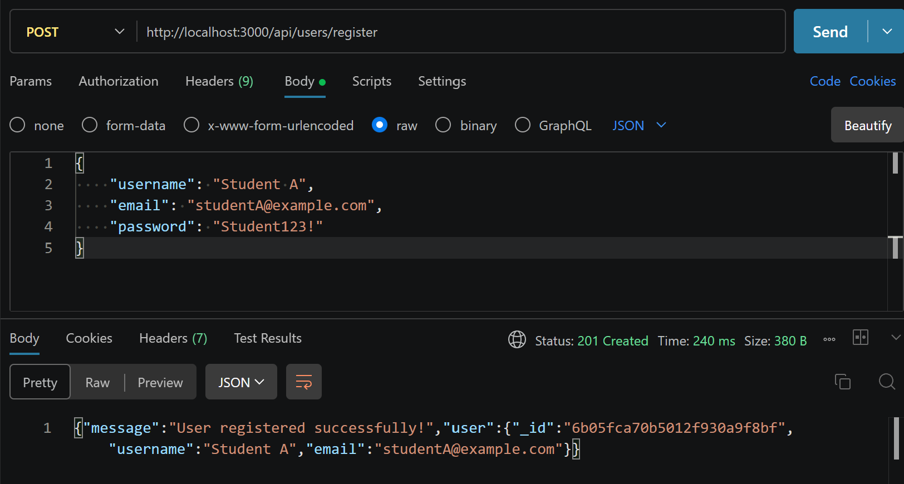
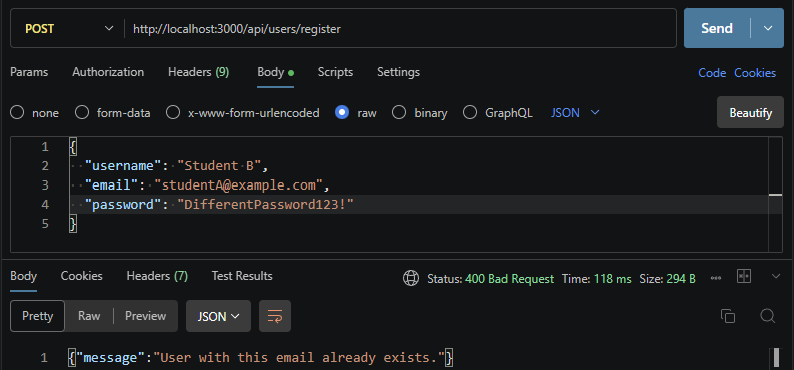
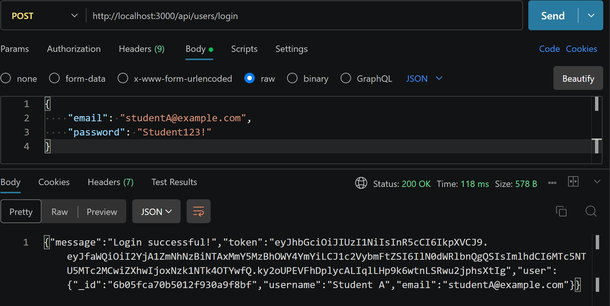
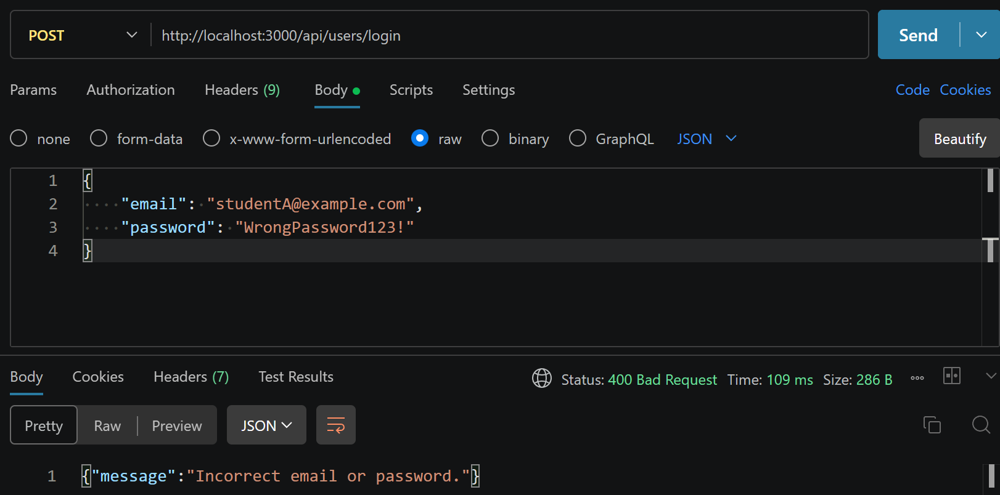
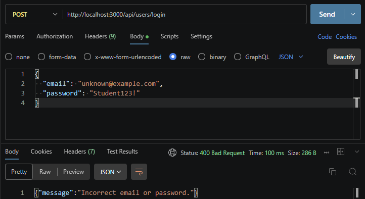
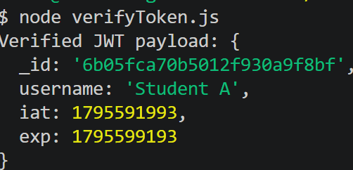

# Basic Login System using Node.js, Express, and MongoDB

## 1. Project Overview

This project implements a basic user authentication system using Node.js, Express.js, and MongoDB.

It allows users to register with a username, email, and password and log in using their registered credentials.

Passwords are securely hashed using bcrypt before being stored in MongoDB. JSON Web Tokens (JWT) are generated after successful login to establish user authentication.

The project demonstrates the implementation of user registration, login, password security, and JWT generation and verification.

## 2. Technologies Used

The following technologies and packages were used to develop this project:

- **Node.js** – JavaScript runtime environment.
- **Express.js** – Web framework used to create the server and API routes.
- **MongoDB** – NoSQL database used to store user information.
- **Mongoose** – ODM library used to define user schemas and interact with MongoDB.
- **bcrypt** – Used to hash passwords and verify user credentials.
- **jsonwebtoken** – Used to generate and verify JSON Web Tokens.
- **dotenv** – Used to load environment variables from the `.env` file.
- **Postman** – Used to test API endpoints and verify responses.

## 3. Project Features

The application includes the following features:

- **User Registration:** Allows new users to register with a username, email, and password.
- **Duplicate Email Validation:** Checks whether an email address is already registered before creating a new user.
- **Password Hashing:** Uses bcrypt to hash passwords automatically through a Mongoose pre-save hook before saving user documents.
- **User Login:** Authenticates existing users using their registered email and password.
- **Password Verification:** Uses a custom `isCorrectPassword()` method to compare the entered password with the stored password hash.
- **JWT Generation:** Generates a signed JSON Web Token after successful login.
- **JWT Payload:** Includes the user's `_id` and `username` in the token payload.
- **Token Expiration:** Configures JWT tokens to expire after two hours.
- **JWT Verification:** Verifies the generated token using the JWT secret.
- **Error Handling:** Returns appropriate HTTP status codes and error messages for unsuccessful registration and login attempts.

## 4. Project Folder Structure

The project is organized into separate folders to keep the application modular and maintainable.

```text
basic_login_system/
│
├── config/
│   └── db.js                  # MongoDB connection configuration
│
├── models/
│   └── User.js                # User schema and password security methods
│
├── routes/
│   └── userRoutes.js          # User registration and login routes
│
├── screenshots/               # API testing screenshots
│
├── .env                       # Environment variables (not committed)
├── .gitignore                 # Files and folders excluded from Git
├── index.js                   # Main application entry point
├── package.json               # Project dependencies and scripts
└── package-lock.json          # Exact dependency versions
```

### Description of Important Files

- **index.js:** Initializes the Express application, configures JSON middleware, connects the user routes, and starts the server.
- **config/db.js:** Establishes a connection between the application and MongoDB using Mongoose.
- **models/User.js:** Defines the User schema, hashes passwords using a pre-save hook, and provides a method to verify passwords.
- **routes/userRoutes.js:** Implements the user registration and login API endpoints.
- **.env:** Storesconfiguration values such as the MongoDB connection string, JWT secret, and server port.

.gitignore: Prevents sensitive files and unnecessary folders, such as .env and node_modules, from being committed to GitHub.


## 5. API Endpoints

The application provides two REST API endpoints for user registration and login.

Both endpoints use the HTTP `POST` method and accept JSON request bodies.

### 5.1 User Registration

**Endpoint:** `POST /api/users/register`

**Description:** Registers a new user by accepting a username, email, and password.

**Request Body:**

```json
{
  "username": "Student A",
  "email": "studentA@example.com",
  "password": "Student123!"
}
```

**Successful Response:**

- **Status Code:** `201 Created`

```json
{
  "message": "User registered successfully!",
  "user": {
    "_id": "generated_user_id",
    "username": "Student A",
    "email": "studentA@example.com"
  }
}
```

The password is not included in the response.

**Error Response – Duplicate Email:**

- **Status Code:** `400 Bad Request`

```json
{
  "message": "User with this email already exists."
}
```

### 5.2 User Login

**Endpoint:** `POST /api/users/login`

**Description:** Authenticates an existing user using their registered email and password. If the credentials are correct, the application generates a signed JWT.

**Request Body:**

```json
{
  "email": "studentA@example.com",
  "password": "Student123!"
}
```

**Successful Response:**

- **Status Code:** `200 OK`

```json
{
  "message": "Login successful!",
  "token": "<generated_jwt_token>",
  "user": {
    "_id": "generated_user_id",
    "username": "Student A",
    "email": "studentA@example.com"
  }
}
```

The JWT token is generated dynamically after successful authentication.

**Error Response – Incorrect Email or Password:**

- **Status Code:** `400 Bad Request`

```json
{
  "message": "Incorrect email or password."
}
```

The same error response is returned in both of the following situations:

- The email address does not exist in the database.
- The email address exists, but the password is incorrect.

This helps avoid revealing whether an email address is registered in the application.

### 5.3 API Endpoint Summary

| HTTP Method | Endpoint | Purpose | Success Status |
|---|---|---|---|
| POST | `/api/users/register` | Register a new user | 201 Created |
| POST | `/api/users/login` | Authenticate an existing user | 200 OK |

## 6. API Testing and Screenshots

The API endpoints were tested using Postman to verify successful registration, duplicate email handling, successful login, incorrect password handling, and JWT verification.

The following screenshots demonstrate the API testing results.

### 6.1 Successful User Registration

A new user was successfully registered using the `POST /api/users/register` endpoint.

**Expected Result:** `201 Created`



### 6.2 Duplicate Email Validation

The registration endpoint was tested using an email address that was already registered.

**Expected Result:** `400 Bad Request`



### 6.3 Successful User Login

An existing user successfully logged in using the registered email and password.

**Expected Result:** `200 OK`



### 6.4 Incorrect Password Validation

The login endpoint was tested with an incorrect password to verify that unauthorized login attempts are rejected.

**Expected Result:** `400 Bad Request`



### 6.5 Login with a Non-Existent User

The login endpoint was tested using an email address that was not registered in the database.

**Expected Result:** `400 Bad Request`



### 6.6 JWT Verification

The JWT generated after successful login was verified using `jsonwebtoken` and the configured JWT secret.

The decoded payload contained the user's `_id`, `username`, token issue time (`iat`), and expiration time (`exp`).



## 7. Challenges Faced and How I Addressed Them

During the development and testing of this project, I encountered a few challenges that helped me better understand Node.js, Express, MongoDB, password security, and JWT authentication.

### 7.1 Missing JWT Dependency

**Challenge:**

When implementing the login route, the application initially produced an error because the `jsonwebtoken` package was not installed in the project.

**How I Addressed It:**

I installed the missing dependency using:

```bash
npm install jsonwebtoken
```

This updated `package.json` and `package-lock.json`. After installing the package, the application started successfully.

### 7.2 Understanding JWT Generation and Verification

**Challenge:**

Although I had implemented JWT generation using `jwt.sign()`, I needed to understand how to verify the generated token and retrieve its payload.

**How I Addressed It:**

I created a temporary `verifyToken.js` script to test token verification independently using `jwt.verify()` and the JWT secret stored in the environment variables.

During testing, I encountered JWT verification errors because the token value was incomplete or incorrectly copied. After correcting the token value, verification succeeded.

The decoded payload displayed the user's `_id`, `username`, issue time (`iat`), and expiration time (`exp`).

This helped me understand how a signed JWT can be verified and how its payload can be retrieved.

**Reference Image:** `05-jwt-verification.png`

### 7.3 Testing Duplicate Email Validation

**Challenge:**

I wanted to verify that the registration endpoint prevented users from registering with an email address that already existed in MongoDB.

**How I Addressed It:**

I tested the registration endpoint in Postman using an email address that had already been registered.

I also changed the username and password while keeping the email address the same. The application correctly returned a `400 Bad Request` response with the message:

```json
{
  "message": "User with this email already exists."
}
```

This confirmed that the duplicate email check worked independently of the other registration fields.

**Reference Image:** `02-duplicate-email.png`

### 7.4 Testing Login with a Non-Existent User

**Challenge:**

I wanted to verify that the login endpoint correctly handled login attempts using an email address that was not registered in the database.

**How I Addressed It:**

I tested the login endpoint in Postman using an email address that did not exist in MongoDB.

The application correctly returned a `400 Bad Request` response with the message:

```json
{
  "message": "Incorrect email or password."
}
```

This confirmed that the application rejected login attempts from non-existent users without revealing whether a particular email address was registered.

**Reference Image:** `06-login-nonexistent-user.png`

## 8. Future Improvements

Although the project successfully implements user registration, login, password hashing, and JWT generation and verification, several additional features could further improve its security and functionality.

The following enhancements could be considered for future development:

1. **JWT Authentication Middleware:** Implement middleware to verify JWT tokens before allowing access to protected API routes.

2. **Protected Routes:** Introduce routes that can only be accessed by authenticated users with valid JWT tokens.

3. **Rate Limiting:** Limit the number of login attempts within a specific time period to help prevent brute-force attacks.

4. **Account Lockout:** Temporarily lock user accounts after multiple consecutive failed login attempts to provide additional protection against unauthorized access.

5. **Password Reset:** Implement a secure password reset mechanism to allow users to recover access to their accounts if they forget their passwords.

These improvements would help extend the basic authentication system into a more comprehensive and secure user authentication solution.